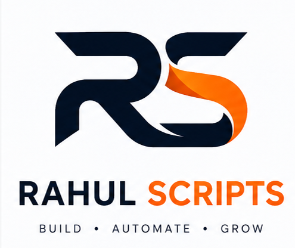

# ⚡ All-In-One Browser Profile Generator (Windows)

<div align="center">
  
  <h3>🔥 Developed by Mr.Rahul Scripts 🔥</h3>
  <p><em>BUILD • AUTOMATE • GROW</em></p>
</div>

Computer me install sabhi browsers (**Google Chrome, Microsoft Edge, Opera, Opera GX, Brave, Vivaldi** ya koi bhi **Custom Browser**) ke unlimited profiles aur Desktop shortcuts 1-click me banane ke liye powerful Windows tool. 

Standalone `.exe` format me bina Python install kiye bhi chalta hai!

---

## 🌟 Key Features (खासियतें)
- **Multi-Browser Support (सभी ब्राउज़र्स सपोर्टेड)**:
  - 🌐 **Google Chrome**
  - 🌊 **Microsoft Edge**
  - 🔴 **Opera Browser**
  - 🎮 **Opera GX**
  - 🦁 **Brave Browser**
  - 🔺 **Vivaldi**
  - 📁 **Custom Browser** (Aap computer ka koi bhi browser `.exe` select kar sakte hain)
  - ⚡ **Batch Generate (ALL Browsers)**: Ek click me computer me maujood sabhi browsers ke profiles ek sath banayein!
- **Auto-Detection**: Tool open hote hi computer me install sabhi browsers ko automatically scan aur detect kar leta hai.
- **Unlimited Profiles**: 5, 10, 50, 100, 500 ya jitne chahein utne independent profiles ek click me ready.
- **Independent Logins & Cookies**: Har profile ka apna alag login session, cookies, history aur extensions.
- **Custom Prefix**: `Chrome 1`, `Edge 1`, `Opera 1`, ya custom jaise `Work 1`, `Bot 1` etc.
- **Auto-Open URL**: Profile launch hote hi kaunsi website khulni chahiye (jaise google.com ya client link).
- **Clean / Delete Option**: Galti se bane shortcuts ko 1-click me Desktop se delete karein.
- **Custom App Icon & Logo**: Mr.Rahul Scripts official logo aur icon ke sath.

---

## 🚀 How to Use (Kaise Use Karein)

### Tarika 1: Direct Standalone EXE (Sabse Best - No Python Needed)
1. Folder me bane **`Chrome_Profile_Generator.exe`** par direct double click karein.
2. Iske liye computer me Python ki koi jarurat nahi hai.
3. Apna Browser select karein (Chrome, Edge, Opera, ya All).
4. **"Profiles Count"** me number dalein aur **"GENERATE PROFILES NOW"** dabayein.

### Tarika 2: Double-Click Launcher (Python Scripts)
1. Is folder me **`Run_Silent.vbs`** ya **`Run_Generator.bat`** par double click karein.
2. Software ka graphical window open ho jayega.

### Tarika 3: Command Line (CMD / PowerShell)
```powershell
# Chrome ke 10 profiles:
python main.py --count 10 --browser chrome

# Microsoft Edge ke 25 profiles:
python main.py --count 25 --browser edge

# Opera ke 10 profiles:
python main.py --count 10 --browser opera

# Computer ke SABHI installed browsers ke profiles ek sath:
python main.py --count 10 --browser all

# Generated shortcuts delete karne ke liye:
python main.py --delete --prefix "Edge"
```

---

## 📁 Files Structure
- `Chrome_Profile_Generator.exe`: Standalone ready-to-use software.
- `Build_EXE.bat`: 1-click script to recompile EXE.
- `main.py`: Main entry point (GUI + CLI).
- `gui.py`: Modern dark-theme desktop graphical interface.
- `profile_generator.py`: Multi-browser shortcut creation engine.
- `assets/`: Official icons and logo files.
- `Run_Silent.vbs`: Silent launcher.
- `Run_Generator.bat`: Windows batch launcher.
